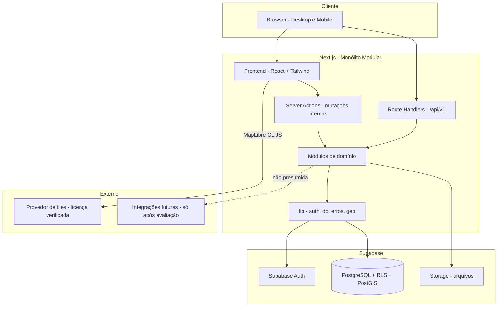

# 01 — Diagrama de Arquitetura

**Versão:** 0.1 · **Status:** proposto (pré-código) · **Data:** 2026-11-23

---

## 1. Visão geral

Monólito modular (Skill 02, seção 4) com backend embutido no Next.js e serviços gerenciados (Supabase). Sem microsserviços.

## 2. Camadas

| Camada | Responsabilidade | Regra |
|--------|------------------|-------|
| UI | Renderização, formulários, mapas | Sem regra de negócio; sem lógica sensível |
| Server Actions | Mutações internas da interface | Validam com Zod; autorização no servidor |
| Route Handlers | Contrato de API `/api/v1` | Mesmo pipeline de validação + autorização |
| Módulos de domínio | Regras de negócio por módulo (clientes, drones, missões...) | Não dependem da interface; testáveis isoladamente |
| lib | Infra compartilhada: cliente Supabase, sessão, erros, utilitários geo | Nenhum módulo acessa o banco direto, fora do RLS |
| Supabase | Persistência, auth, arquivos | **RLS em toda tabela empresarial**; service_role só no servidor |

## 3. Fronteiras de segurança (obrigatórias)

1. Identificador de organização vem da **sessão validada no servidor** — nunca confiar no corpo da requisição (Skill 02, 5.3).
2. `service_role` e chaves administrativas: apenas variáveis de ambiente de servidor; jamais no bundle do cliente.
3. Toda autorização acontece antes de tocar o domínio (checagem de membership + papel).
4. Mapas exibidos são **genéricos** — nenhuma camada aeronáutica oficial pode ser sugerida na UI (doc 08 da Skill 01).

## 4. Evolução prevista (não construir agora)

- Fila de jobs / webhooks: só quando houver necessidade mensurável (ex.: relatórios pesados).
- Microsserviços: não antes de dor real de escala ou deploy independente.
- Integrações externas (qualquer órgão): apenas após avaliação de documentação, autorização, segurança e viabilidade — ver ADR-010.
