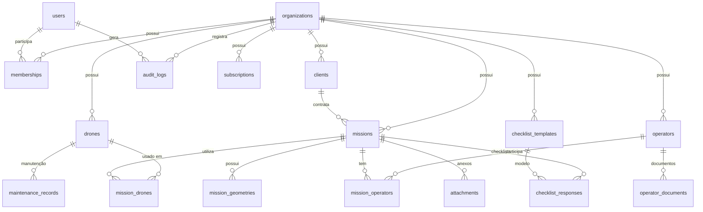

# 03 — Modelo Entidade-Relacionamento

**Versão:** 0.1 · **Status:** proposto (pré-código — revisar com Skill 04/06 antes da primeira migração) · **Data:** 2026-11-23

---

## 1. Convenções

- `id` = UUID v4 (gerado no servidor).
- `organization_id` presente em **toda** tabela empresarial (Skill 02, 5.1) — única base do RLS.
- `created_at` / `updated_at` = `timestamptz`.
- `deleted_at` = exclusão lógica onde aplicável (Skill 02, 6).
- Geometrias em coluna `geometry` (PostGIS) + coluna `geojson` ou geração via função.

## 2. Diagrama

## 3. Tabelas

### Núcleo multi-tenant

| Tabela | Papel | Exclusão |
|--------|-------|----------|
| `organizations` | Tenant. Nome, slug, status, criado em `auth.users` do dono | Lógica |
| `users` | Espelho do perfil (nome, email) ligado a `auth.users` | Lógica |
| `memberships` | **Vínculo usuário↔organização** com `role` (owner/admin/member) + `status` | Simples |
| `subscriptions` | Plano hipotético (free/pro/enterprise), status, período | — |

### Domínio

| Tabela | Relações principais | Observação |
|--------|---------------------|------------|
| `clients` | 1 org → N missões | Nome, contato, CNPJ opcional |
| `drones` | N org, N missões | Fabricante, modelo, nº série, características JSONB, status |
| `maintenance_records` | N drones | Data, descrição, custo opcional |
| `operators` | N org, N missões | Pode vincular `user_id` opcional |
| `operator_documents` | N operadores | Tipo, arquivo, **validade** (alertas = condicionado, doc 08) |
| `missions` | N clients, N org | Data, status, objetivo, observações, responsável (`user_id`) |
| `mission_operators` | missões ↔ operadores | Papel na missão |
| `mission_drones` | missões ↔ drones | Papel do equipamento |
| `mission_geometries` | N missões | `geometry` (Point/LineString/Polygon), tipo, ordem, SRID 4326 |
| `checklist_templates` | 1 org → N respostas | Definição editável |
| `checklist_items` | N templates | Ordem, texto, obrigatório |
| `checklist_responses` | missão + template | Dados preenchidos (JSONB) |
| `attachments` | qualquer entidade | Buckets por organização, tabela registra caminho + dono |
| `reports` | N missões/org | Tipo, parâmetros, status de geração |
| `audit_logs` | N org, N users | Ação, entidade, antes/depois (JSONB), IP opcional |

## 4. Regras de integridade

1. FK obrigatórias em todas as relações; índices em FKs e `(organization_id, ...)`.
2. **Unique por organização:** `drones.serial_number` (quando informado), `clients.name` (decidir na migração — pode ser fonte de atrito), `mission` número sequencial por org se existir.
3. `missions.organization_id` deve ser coerente com o `clients.organization_id` referenciado — **CHECK via trigger de aplicação ou regra no service** (validar na migração 0004).
4. SRID único (4326) para todas as geometrias; sem mistura de sistemas de referência.
5. Nenhuma tabela sem necessidade identificada (Skill 02, 6) — listas acima cobrem apenas o MVP do doc 02.

## 5. Isolamento (resumo — detalhe no doc 05 e ADR-003)

- RLS habilitado em **toda** tabela empresarial.
- Policy base: `organization_id = (SELECT organization_id FROM current_membership())` — helper que lê a organização **da sessão**, nunca do payload.
- Nenhuma policy com `USING (true)` ou default-permitido (Skill 02, 5.7).
- Testes obrigatórios: acesso autorizado, acesso cruzado negado, papel insuficiente negado.
